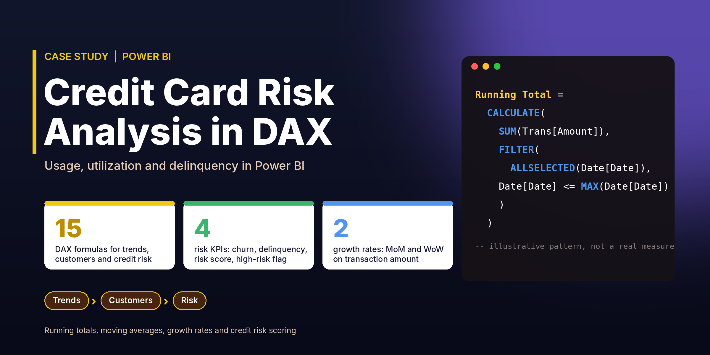

<h1 align="center">Credit Card Financial Analysis — DAX Measures in Power BI</h1>

<p align="center">
  
  
  
  
</p>

<p align="center">
  
</p>

## Overview

A Power BI project that analyses credit card usage and financial metrics for a banking institution by writing DAX measures. The measures cover financial trends (running totals, moving averages, growth rates), customer behaviour, credit utilization and delinquency risk, to support better customer retention and financial performance. The report answers:

- How are transaction volumes and credit limits trending over time?
- Which clients spend the most, and which are close to their credit limit?
- Which clients look like churn, delinquency or high credit-risk cases?
- How do credit limits relate to income, satisfaction and personal-loan approval?

## The Measures

*The DAX below is a starting point. It assumes a fact table `Credit` (one row per client and date) plus a `Date` table. Replace the table and column names with those in your model, and treat any threshold or weight as an assumption to confirm.*

| # | Measure | DAX approach |
|---|---|---|
| 1 | Running total of transactions | `CALCULATE(SUM(Credit[Total_Trans_Amt]), FILTER(ALLSELECTED('Date'[Date]), 'Date'[Date] <= MAX('Date'[Date])))` |
| 2 | 4-week moving average of `Credit_Limit` per client | `CALCULATE(AVERAGE(Credit[Credit_Limit]), DATESINPERIOD('Date'[Date], MAX('Date'[Date]), -28, DAY))`, with the client on the visual or as a slicer |
| 3 | MoM % and WoW % growth on transaction amount | `VAR Prev = CALCULATE([Total Trans Amt], DATEADD('Date'[Date], -1, MONTH)) RETURN DIVIDE([Total Trans Amt] - Prev, Prev)`; for WoW use `DATEADD(..., -7, DAY)` at week level |
| 4 | CAC as a ratio of transaction amount | `DIVIDE(SUM(Credit[Customer_Acq_Cost]), SUM(Credit[Total_Trans_Amt]))` |
| 5 | Yearly average `Avg_Utilization_Ratio` for all clients | `CALCULATE(AVERAGE(Credit[Avg_Utilization_Ratio]), REMOVEFILTERS(Credit[Client_Num]))`, with Year on the axis |
| 6 | Interest earned as % of `Total_Revolving_Bal` per client | `DIVIDE(SUM(Credit[Interest_Earned]), SUM(Credit[Total_Revolving_Bal]))` |
| 7 | Top 5 clients by total transaction amount | `Client Rank = RANKX(ALL(Credit[Client_Num]), [Total Trans Amt])`, then `IF([Client Rank] <= 5, [Total Trans Amt])` (or a Top N visual filter) |
| 8 | Clients with `Avg_Utilization_Ratio` above 80% | `CALCULATE(DISTINCTCOUNT(Credit[Client_Num]), Credit[Avg_Utilization_Ratio] > 0.8)` (assumes the ratio is stored as 0 to 1) |
| 9 | Churn indicator: no transactions in the last 6 months | `VAR Amt = CALCULATE(SUM(Credit[Total_Trans_Amt]), DATESBETWEEN('Date'[Date], EDATE(MAX('Date'[Date]), -6), MAX('Date'[Date]))) RETURN IF(ISBLANK(Amt) \|\| Amt = 0, "Churn Risk", "Active")` |
| 10 | Delinquency rate: % of clients with `Delinquent_Acc` > 0 | `DIVIDE(CALCULATE(DISTINCTCOUNT(Credit[Client_Num]), Credit[Delinquent_Acc] > 0), DISTINCTCOUNT(Credit[Client_Num]))` |
| 11 | Credit risk score | Weighted blend of utilization, delinquency and revolving balance (see below) |
| 12 | Correlation between `Income` and `Credit_Limit` | Pearson formula built with `SUMX` (see below), plus a scatter chart |
| 13 | Average `Cust_Satisfaction_Score` by `Card_Category` | `AVERAGE(Credit[Cust_Satisfaction_Score])` with `Card_Category` on the axis |
| 14 | Average credit limit with vs. without a personal loan | `CALCULATE(AVERAGE(Credit[Credit_Limit]), Credit[Personal_loan] = 1)` and the same with `= 0` (assumes a 1/0 flag) |
| 15 | High-risk client flag | `IF(SUM(Credit[Total_Revolving_Bal]) > 0.9 * SUM(Credit[Credit_Limit]) && AVERAGE(Credit[Avg_Utilization_Ratio]) > 0.8, "High Risk", "Not High Risk")` |

**Measure 11: credit risk score (weights and caps are my assumptions)**

```
Credit Risk Score =
100 * (
    0.4 * AVERAGE(Credit[Avg_Utilization_Ratio])
  + 0.4 * MIN(DIVIDE(MAX(Credit[Delinquent_Acc]), 3), 1)
  + 0.2 * MIN(DIVIDE(SUM(Credit[Total_Revolving_Bal]), SUM(Credit[Credit_Limit])), 1)
)
```

A higher score means higher risk. Delinquent accounts are capped at 3 so one extreme value doesn't dominate, and the weights favour the two strongest warning signs.

**Measure 12: correlation (DAX has no built-in Pearson function)**

```
Income vs Credit Limit Correlation =
VAR n   = COUNTROWS(Credit)
VAR sx  = SUM(Credit[Income])
VAR sy  = SUM(Credit[Credit_Limit])
VAR sxy = SUMX(Credit, Credit[Income] * Credit[Credit_Limit])
VAR sx2 = SUMX(Credit, Credit[Income] ^ 2)
VAR sy2 = SUMX(Credit, Credit[Credit_Limit] ^ 2)
RETURN DIVIDE(n * sxy - sx * sy, SQRT((n * sx2 - sx ^ 2) * (n * sy2 - sy ^ 2)))
```

This assumes one row per client for the correlation. If the table has several rows per client, summarise it to one row per client first.

## Tech Stack

```
Microsoft Power BI
├── Power Query      → Data ingestion and cleaning
├── Data Modelling   → Credit fact table linked to a Date table
├── DAX              → Time intelligence, ranking, flags and risk scoring
└── Visuals          → Line, bar, scatter, card and table visuals for the measures
```

*Adjust this block to match what you actually built.*

## Data Quality and Modelling Notes

- Time-based measures (1, 2, 3, 9) need a proper `Date` table marked as a date table and related to the fact table.
- The utilization thresholds (80% and 90%) and the risk-score weights are my assumptions and should be agreed with the business.
- `Personal_loan` and `Avg_Utilization_Ratio` formats (1/0 versus text, 0 to 1 versus 0 to 100) should be checked before using the formulas as written.
- The dataset link is a shared folder, so file and column names should be confirmed against the actual files.

## How to Use

1. Clone or download this repository.
2. Open `Credit_Card_Analysis.pbix` in Microsoft Power BI Desktop.
3. Open the Model view to see the measures and the relationships.
4. Use the slicers to filter by client, card category and date.
5. All visuals update automatically.

## Repository Structure

```
credit-card-dax-analysis
├── Credit_Card_Analysis.pbix        ← Main Power BI report (add your file here)
├── Credit_Card_DAX_Presentation.pptx ← Measures, formulas and screenshots (add your file here)
├── cover.png                        ← Repo cover image
└── README.md
```

---

## About Me

**Anmol Agarwal**
Business Analyst

[](https://www.linkedin.com/in/anmol-agarwal123/)
[](https://github.com/Anmolagarwal19)
[](mailto:agarwalanmol799@gmail.com)

*If this project was useful, a star on the repo is appreciated — feel free to reach out for feedback, questions, or opportunities.*
